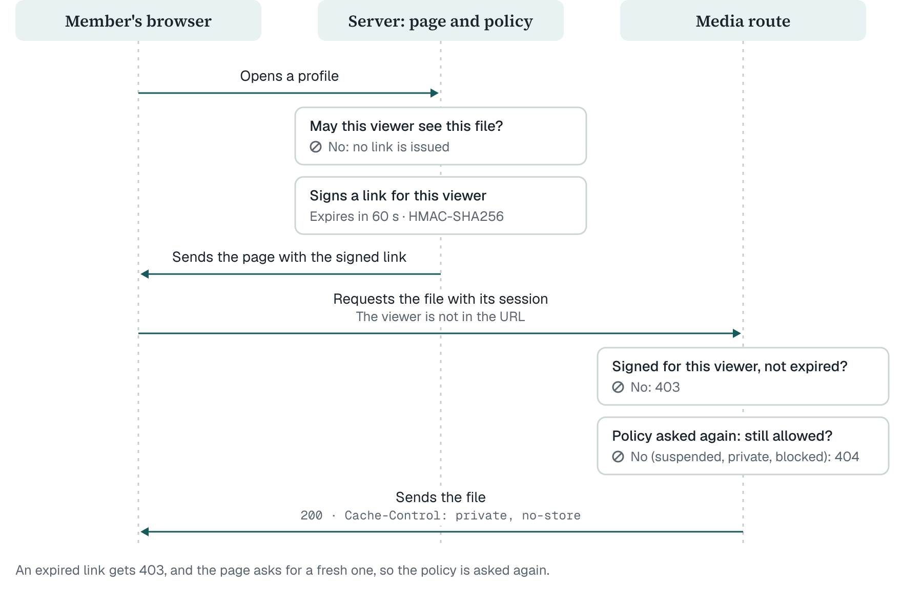

# Trust gate demo

Verified community: hidden by default, video-checked by a person.

A small working sample of the trust and safety layer for a members-only community. Every new member is screened by a
moderator, who compares a verification video (2 to 5 minutes, five prompts, every language on the profile) with their
photo before the profile is visible to anyone. Photos and videos have no public URL. The hidden-by-default rules are
enforced in one place and proved by automated tests.

Live demo: https://verified-community-gate.vercel.app

## What it proves

| Rule | Where to see it |
| --- | --- |
| **Signup and consent.** 18+ confirmation, versioned terms with the time of acceptance, and a separate, unticked consent for faith-related answers. Optional and faith fields come from one config file (`lib/profile-fields.ts`). | `/join`, `/terms`, `/me` |
| **Video verification.** A photo plus a recording that answers five prompts (three fixed, two the member chooses) in every language on the profile. Here a 6-second fictional clip stands in for the 2 to 5 minute recording. The profile stays invisible until approved; replacing the photo or video sends it back to review. | `/join/verify`, `/me` |
| **Moderator dashboard.** Review queue, photo and video side by side with a checklist (same person, each prompt, each language, recording length), stated country against the country detected at signup (staff only), approve, reject with a reason, flag, notes, reports, audit log. Moderators and admins have different permissions (only admins suspend, ban, reinstate and give complimentary access). Reinstating restores the status a suspension interrupted, so a pending profile never skips review. | `/moderate`, `/moderate/[id]`, `/moderate/audit` |
| **Private media.** Files live outside `public/`. They are served only by one route, through 60-second links signed with HMAC-SHA256 over the asset, the viewer and the expiry, and the access policy is checked again on every request. Members can set their photo and video to approved members or private. | `/api/media/[assetId]`, `/me` |
| **Hidden by default.** Pending, rejected, suspended and banned accounts never appear in search or messages, direct links return a real 404, and those accounts cannot see members or media themselves. A block between two members hides them from each other only. Three open reports hide a profile until a moderator reviews them. | `/members`, `/members/[id]`, `/messages` |
| **Subscriptions.** Browsing and replying are free; starting a conversation needs paid, complimentary or founding access. The processor sits behind one billing interface and writes to the member's own access record; this demo uses a test-mode provider. | `/members/[id]`, `/me`, `/how-it-works#billing` |
| **Tests.** Table-driven unit tests over every status, viewer role, block direction and membership state; the approval checklist; signed links; billing events; Playwright tests in a real browser. | `/tests` |

## Try it

There is no real sign-in. Pick a demo identity from the menu at the top of any page:

- **Your signup:** sign up (or use the sample answers), pick a photo, a video and two prompts, and see that search is
  empty and `/members/m02` is a 404.
- **Amara (member):** browse and filter, accept Priya's message request (free), subscribe in test mode to start a
  conversation, report Samuel (the third report hides him), block someone, switch your photo or video between approved
  members and private, or replace your video and watch the profile go back to review.
- **Morgan (moderator):** open the queue, compare photo and video, tick the checklist and approve, reject with a reason,
  flag, add notes, review reports, read the audit log.
- **Riley (admin):** everything a moderator does, plus suspend, ban, reinstate and complimentary access.

**Reset demo** clears your changes.

## How it works

**One policy module.** Every read goes through `lib/policy.ts`: `isVisible(viewer, target)`, `listVisibleMembers(viewer, filters)`,
`canMessage(a, b)`, `canStartConversation(a, b)`, `canAccessMedia(viewer, asset)` and the staff permissions. Pages,
route handlers and server actions never filter on their own; when the policy says no, the page calls `notFound()`. State
changes are pure functions in `lib/domain.ts` that ask the same policy for permission.

**Approval gate.** `lib/verification.ts` decides whether a recording can be approved: five prompts including the three
fixed ones, 2:00 to 5:00 long, and a moderator's ticks for the same person, every prompt and every language. The
checklist is saved in the audit log with the approval.

**Signed media links.**



`lib/media-signing.ts` issues `/api/media/<asset>?exp=<unix>&sig=<hmac>` only after the policy
allows it. The viewer is not in the URL: the media route recomputes the signature with the viewer from the session,
compares it in constant time, checks the expiry, then asks the policy again. Responses:

- `200` with `Cache-Control: private, no-store` (byte ranges supported for video),
- `403` for a missing, altered, expired or foreign signature,
- `404` when the signature is fine but the viewer may not know the file exists.

A page restored by Back after its links expired asks for fresh ones. In a real build the same issuer would sign
Cloudflare Stream tokens or Bunny.net token-authentication URLs instead; `/how-it-works` shows the mapping.

**Billing.** `lib/billing.ts` defines the `BillingProvider` interface (checkout, cancel, webhook) and `applyBillingEvent`,
which writes each processor event to the member's access record once, by event id. `lib/access.ts` holds the rule for
starting a conversation. Stripe and Authorize.net adapters would implement the same interface.

**State without a database.** The fictional seed data lives in `lib/seed.ts`. Everything a visitor changes (their signup,
moderator decisions, notes, blocks, reports, audit entries) is stored in their own sandbox: one httpOnly cookie,
validated with zod and sealed as a JWE (direct key, AES-256-GCM), so it is encrypted and tamper-evident. The cookie keeps
the latest 25 audit entries per visitor; a change that would no longer fit is refused with a clear message instead of
being lost. On every request the server rebuilds the state as seed plus sandbox.

The sandbox exists only so the demo needs no database. In production the same policy functions would run on Postgres
queries, with row-level security enforcing the same rule a second time inside the database as defence in depth.

## Run it locally

Requires Node 20 or newer and pnpm.

```bash
pnpm install
pnpm dev            # http://localhost:3000, uses development-only secrets
```

For a production build, set two secrets first (never commit them):

```bash
cp .env.example .env.local
# fill both values with: openssl rand -hex 32
pnpm build && pnpm start
```

| Variable | Purpose |
| --- | --- |
| `MEDIA_SIGNING_SECRET` | HMAC key for media links |
| `SESSION_SECRET` | Key for the encrypted sandbox cookie (and the test-mode billing webhooks) |

## Tests and checks

```bash
pnpm test                                     # Vitest: policy matrix, approval gate, signed links, billing, sandbox, workflows
pnpm test:e2e                                 # Playwright against a local production build (port 3302)
BASE_URL=https://example.app pnpm test:e2e    # Playwright against a deployment
pnpm lint
pnpm typecheck
pnpm build                                    # runs the unit tests, then next build
```

`pnpm exec playwright install chromium` installs the browser the first time. `pnpm build` writes the unit test results
to `test-output/`, and the `/tests` page lists every test from that run, with a visibility matrix built from the results.

To record an end-to-end run for the `/tests` page, run the suite with `E2E_RECORD=1` and then
`node scripts/summarize-e2e.mjs`, which writes a small summary to `reports/e2e-latest.json` for the next deploy.

## Project layout

```
app/                      routes, server actions (app/actions.ts) and the media route
lib/policy.ts             the single access policy
lib/domain.ts             state changes as pure functions
lib/verification.ts       prompts, recording length and the approval checklist
lib/access.ts             who may start a conversation
lib/billing.ts            the billing interface and how events are applied
lib/profile-fields.ts     optional and faith-related profile fields, as config
lib/media-signing.ts      signed link issue and verify
lib/sandbox*.ts           the per-visitor cookie sandbox
lib/seed.ts               fictional members, conversations, reports and audit history
lib/server/               session, request gate, secrets (server only)
private-media/            fictional portraits and clips, outside public/
tests/unit/               Vitest suites
e2e/                      Playwright suites
scripts/make-media.mjs    rebuilds the fictional portraits and clips (needs ffmpeg and rsvg-convert)
```

## Your Phase 1 list against this sample

| | Requirement | In this sample | Later |
| --- | --- | --- | --- |
| R1 | Signup and profiles | Working: 18+, versioned terms, separate faith consent, config-driven fields | M1: your full ~15 fields |
| R2 | Video verification | Working with sample files: five prompts, languages, length check, back to review on replace | M2: recording and upload |
| R3 | Moderator dashboard | Working: queue, checklist, decisions, notes, country check, audit log, roles | M2: alerts |
| R4 | Private media | Working: signed, viewer-bound, re-checked links; member visibility settings | M2: Cloudflare Stream or Bunny.net |
| R5 | Hidden by default | Working, proved by tests | |
| R6 | Subscriptions | Sketched: access rule, complimentary with end date, founding counter, test-mode checkout | M3: Stripe or Authorize.net adapter |
| R7 | Messaging | Partly: request, accept, decline, block, report | M4: sending, email notifications |
| R8 | Browse and search | Working | |
| R9 | Safety | Partly: reports with auto-hide at three, suspend, ban, reinstate | M5: warn, restrict, email and IP bans, text screening |
| R10 | Privacy | Consent records only | M5: export and deletion, regional notices |
| R11 | Security | Partly: tests for the hidden-by-default rules, signed links, encrypted state | M5, M6: staff 2FA, backups with a tested restore, review fixes |
| R12 | Responsive, calm design | Working; English only | M1: translation-ready strings |
| R13 | Handover | README and tests here | M6: your GitHub, documentation, warranty |

## Limits of the demo

- Identities are switched from a menu; there is no authentication.
- New members pick from fictional sample files instead of uploading or recording; a 6-second clip stands in for the
  2 to 5 minute recording, and its length is taken from the sample's details.
- Each visitor's changes live only in their own browser; nobody else sees them.
- Media is served from the app's own function. A real build would keep video with a provider and sign provider URLs.
- Billing runs through a test-mode provider with no network; message threads are read-only.

Sample by Bereket A. · fictional people and media
